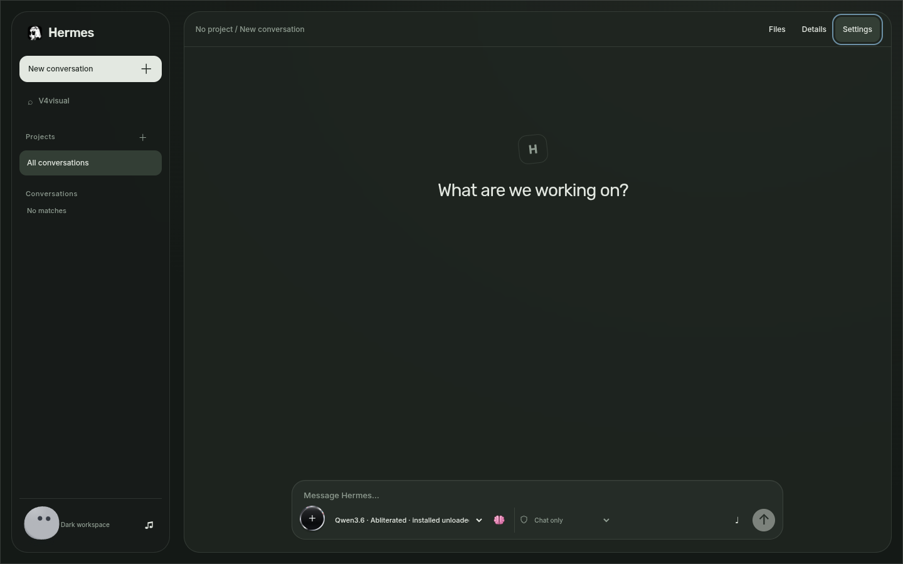
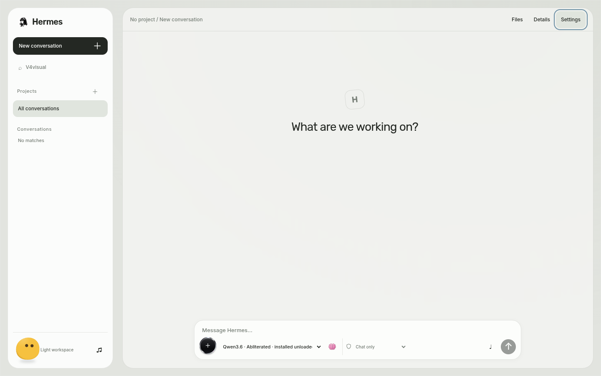

<div align="center">


# Hermes Workspace

**Hermes × your local model.**<br>
Local conversations, persistent projects and explicit boundaries.

[Local use](#local-use) · [Capabilities](#capabilities) · [Production repair and permissions](docs/PRODUCTION_V4.md) · [Operation and recovery](docs/LOCAL_CHAT.md) · [Sources and credits](docs/LOCAL_CHAT_SOURCES.md)



</div>

## The workspace

Ordinary chat needs no project or task selection. Replies stream from the installed local llama.cpp runtime, persist as they arrive and reconnect after reload. Send has an idempotency key; cancellation closes the real inference transport and waits for compute cleanup. The project tree provides nested folders and a separate conversation list. Files, Details and Settings keep stable header positions.

| Dark | Light |
| --- | --- |
|  |  |

The banner retains the accepted repository artwork. The gallery shows the current implementation. Earlier glass/tile recordings remain historical assets; that emission renderer is retired from the current app.

## Capabilities

| Area | Current behavior |
| --- | --- |
| Models | Explicitly linked, hash-verified normal and pinned abliterated Qwen3.6-35B-A3B GGUF files; listing loads nothing |
| Chat | Genuine streamed answers, contextual follow-ups, durable partial output, drafts, reload/replay and per-response cancel |
| Reasoning | Effective template thinking off/on; two positions, not four native effort levels |
| Attachments | Bounded inert file/text context and authenticated media; images are preview-only for these text models |
| Voice | Explicit capture controls, real playback/seek/speed, measured waveform and optional local CPU English transcription |
| Search | Explicit Wikipedia queries, actual excerpts and source links |
| Projects | Nested folders, persistent names/colours, cycle-safe moves and reviewed folder import |
| Deletion | Confirm/cancel/Escape, cleanup acknowledgement and recoverable app-owned deletion |
| Activity | Active-only notch, inline status and real attachment/search task results |
| Permissions | Server-held Chat only / Ask before actions / Workspace agent modes, exact approvals, revocation and final dispatch checks |
| Preferences | Pointer-follow bottom-left theme buddy, persistent mute, accepted short clicks at 12% default and reduced motion |

Normal chat preserves its existing service and 65,536 context. The candidate uses a separately confined 8,192-context backend under the bounded guard. Models execute sequentially. Each candidate reply currently unloads it and restores normal Qwen before the next Send; cold loading can take minutes. Replies have a 1,024-token limit with an explicit limit notice. History is checked against the actual template/tokenizer context and is not silently truncated.

The candidate label identifies the pinned local artifact. Its upstream ablation lineage remains unproven; these checks establish working conversations, not a causal quality benchmark. Physical microphone, assistive technology, alternate browser, high-refresh and human motion/listening coverage remain separate limits.

[v4 measured verification and remaining gaps](docs/V4_VERIFICATION.md): production chat works for both local models. Qualified guest execution remains unavailable while the complete current-boot watchdog gate is unresolved.

## Local use

On the configured workstation, use the existing **Hermes** launcher/pin or `~/.local/bin/hermes-workspace`. The URL is `http://127.0.0.1:18791/hermes-workspace`; open it through the launcher because an unauthenticated URL alone is intentionally denied. The dedicated Brave profile receives an HttpOnly, SameSite=Strict cookie over a private pipe. Opening the app starts no inference, VM or candidate model. An actual Send is the admission boundary.

This source targets the existing Arch/Hyprland installation. It is not a universal machine installer. Models, private setup media, credentials, catalogs and rollback backups are excluded. Native admission still requires the workstation's provenance and security gates. [Preparation, limits and rollback](docs/LOCAL_CHAT.md).

## Build and check

```sh
cd workspace/frontend
npm ci
npm run build
node --test tests/*.test.mjs
cd ../..
python3 -m unittest discover -s tests -v
```

Dependencies are pinned and self-hosted. `workspace/ui/dist/identities.json` identifies the build. Optional CPU transcription preparation is `python3 scripts/prepare_voice.py`; pinned source/model downloads remain outside Git. It requires cmake, a C++ compiler and ffmpeg and downloads no Qwen weights.

Run workstation checks in the native host environment. The motion-encoder regression requires FFmpeg with `libx264`; the editor's Flatpak FFmpeg may omit that encoder.

## Boundaries and credits

The UI remains unprivileged and loopback-only. Authentication, Host/Origin/CSRF checks, schemas and quotas remain enforced. A root-owned operator-only supervisor passes a connected backend descriptor to the unprivileged inference worker; it receives no chat prompt or model reply. Independent pidfd/heartbeat and deadlines own revocation. Chat only grants no tools. Other modes expose a bounded action schema enforced by server policies and exact approvals; guest execution retains its separate native qualification. [Production launch context and contracts](docs/PRODUCTION_V4.md).

Six components are by [Rare UI](https://www.rareui.com), pinned to `9633fcfa81c212a0ba48507e9c56be4869d61928`. Its MIT + Commons Clause and attribution terms are included in [the original license](workspace/ui/licenses/Rare-UI-integrated.txt); preserve them. [Source/adaptation record](docs/LOCAL_CHAT_SOURCES.md), [frontend notices](workspace/ui/licenses/Frontend-packages.txt), font licenses and Kenney CC0 sound provenance accompany the source. No generated visual media was added.
