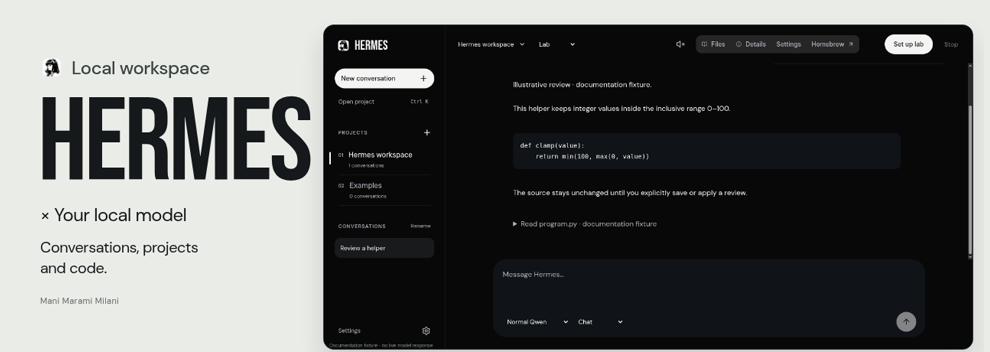
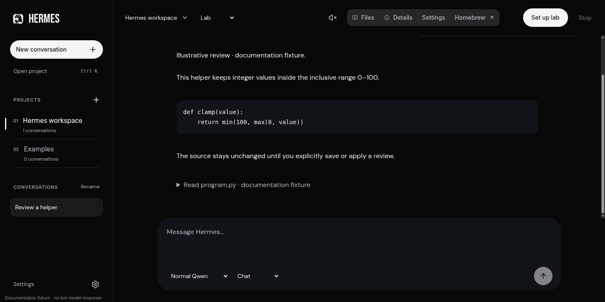
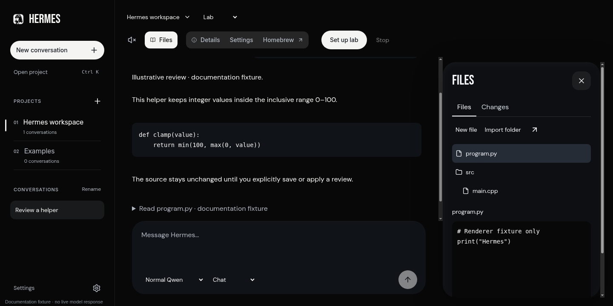
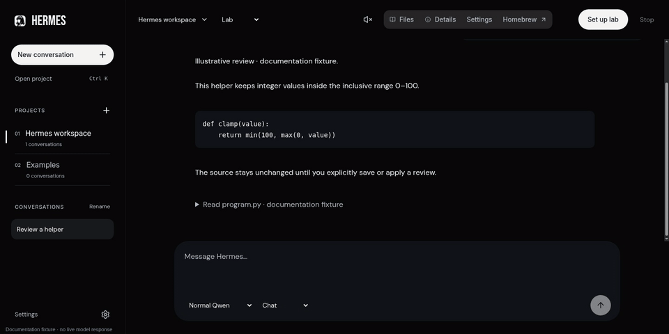
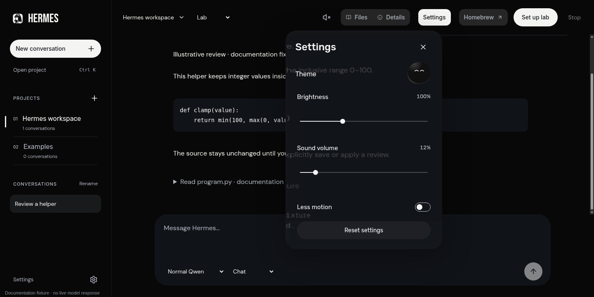
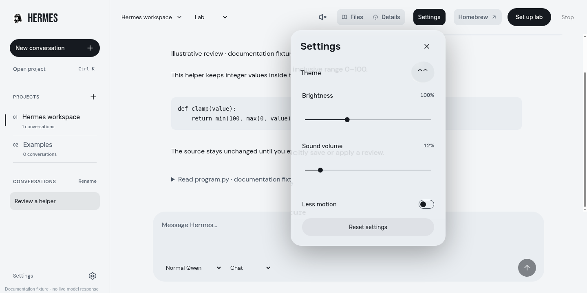
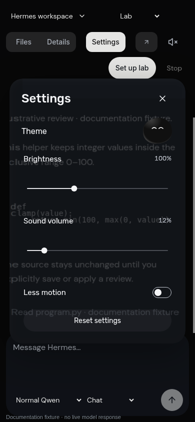
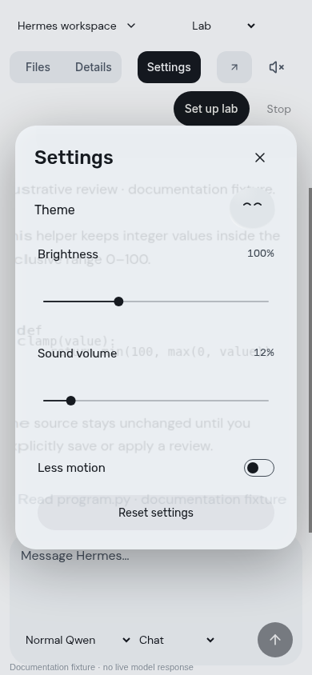

<div align="center">



# Hermes Workspace

**Hermes × your local model.**<br>
A local Hermes interface for persistent projects, file review and a separately controlled guest-execution lab.

[](https://www.python.org/)
[](workspace/ui)
[](workspace/ui/pane-motion.mjs)
[](workspace/README.md)

[Showcase](#the-workspace) · [Features](#built-in) · [Controls](#controls) · [Local use](#local-use) · [Architecture](#architecture) · [Status](#validation-and-current-limits) · [Credits](#credits)

<br>



*Your projects stay local. Execution has an explicit boundary.*

</div>

## The workspace

Hermes keeps projects, conversations and file review in one quiet interface. The project rail provides context, each conversation retains its own model and draft, and Files opens the current project beside the chat. Settings shares the portfolio's native controls, optical glass and source-derived tile motion.

| Conversations | File review |
|:---:|:---:|
|  |  |
| Persistent project context and per-conversation drafts | File tree, staged editing and explicit save/apply controls |



The preview is a silent, resized recording at its original pace. Gallery messages are clearly labelled documentation fixtures, not a live model response or a claim that a backend job succeeded. No private catalog or conversation is included. [Capture sources](showcase/github/README.md).

### Light and dark

| Dark | Light |
|:---:|:---:|
|  |  |

The theme buddy changes appearance. Brightness affects this interface; volume controls the short, predictable press/close sounds. Native range and switch semantics remain available to the keyboard. Less motion provides a settled alternative. Mute stays reachable and persistent.

<details>
<summary><strong>Portrait gallery</strong></summary>

<br>

<p align="center">
  
  
</p>

Narrow layouts use project/conversation dialogs and fitted pane bodies. These captures establish browser rendering, not physical touch-device coverage.

</details>

## Built in

| Area | Behavior |
|:---|:---|
| Projects | Registered local copies, search and explicit folder import review |
| Conversations | Durable history, names, model identity and independent composer drafts |
| Files | Nested tree, literal code/text preview, staged edits and guarded saves |
| Review | Explicit diff review; applying a supported change requires an admitted, matching base |
| Preferences | Light/dark, interface brightness, sound volume, persistent mute and Less motion |
| Motion | Fluid menu seams, distributed tile births, immediate dismissal and interruption-aware return |
| Desktop | A dedicated authenticated Brave app, one reusable Hermes pin and normal Homebrew access |
| Execution boundary | Separately qualified guest tools, external quotas/deadlines and a native Stop path |

Guest tool contracts are deliberately narrow. The UI does not grant a model a host shell, start an inference window or broaden those contracts.

## Controls

| Where | Input | Result |
|:---|:---|:---|
| Project rail | Select; Open project | Change context or search registered projects |
| Conversations | Select; New conversation; Rename | Restore a draft, create a conversation or change its display title |
| Files | Open a tree item | Read the staged project copy |
| File editor | Save; review a diff | Use the existing checked save/review operation |
| Model selector | Select another pinned arm | Create a separate conversation; preserve the old model identity |
| Settings | Theme buddy; ranges; Less motion | Change actual presentation/audio preferences |
| Panes | Close or Escape | Release input immediately and restore focus |
| Homebrew | Activate | Open the separately verified normal Hermes terminal route |
| Set up lab / Start lab | Activate | Display the native operator command; never grant or renew a window |
| Active job | Stop | Request cancellation through the trusted native boundary |

## Local use

This is a workstation integration for an existing Arch/Hyprland, Brave, systemd-user and protected KVM/model setup. It is not a universal installer. The UI needs no frontend dependency install or framework build.

On the configured workstation, use the existing Hermes application pin, or:

```sh
systemctl --user start hermes-workspace.service
~/.local/bin/hermes-workspace
```

The launcher opens `http://127.0.0.1:18791/hermes-workspace` and supplies its private HttpOnly cookie over an owned pipe. Opening that URL in an unrelated browser does not transfer authentication. The service binds only to loopback.

The private catalog, projects and drafts live under `~/HermesLab`; browser state and credentials remain outside this repository. Opening the app starts no VM, model or inference window. Keep normal Hermes/Qwen configuration separate.

For operator setup, bounded execution and recovery, read the [workspace contracts](workspace/README.md), [recovery guide](workspace/RECOVERY.md) and [preserved lab notes](docs/LAB_NOTES.md). Do not run guest solvers on the host.

## Architecture

| Layer | Source | Responsibility |
|:---|:---|:---|
| Presentation | [`workspace/ui`](workspace/ui) | Native controls, conversation/file views, preferences and WebGL2 pane paint |
| Application boundary | [`workspace/server.py`](workspace/server.py) | Authenticated loopback RPC, validation and explicit operations |
| Durable state | [`workspace/catalog.py`](workspace/catalog.py), [`files.py`](workspace/files.py) | Projects, sessions, drafts, file identity and admitted changes |
| Desktop entry | [`workspace/launcher.py`](workspace/launcher.py) | Private browser bootstrap, exact-profile ownership and single-window focus |
| Native control | [`native/jobs.py`](native/jobs.py), [`supervisor.py`](native/supervisor.py) | External job ownership, authorization, limits and cleanup |
| Guest execution | [`guest`](guest), [`lab/relay.py`](lab/relay.py) | Scoped tools and fixed local inference transport across the isolation boundary |

UI state and persistent data have explicit owners. Native controls remain outside model authority; guest output cannot select arbitrary host executables or extend its lease. Source boundaries are not a substitute for current runtime qualification.

## Validation and current limits

The reviewed UI passed **168 Python tests**, **7 focused JavaScript tests** and **446 trusted-pointer checks**. Native Wayland injection was checked at 100/125/150/200% compositor scale; zoom, DPR and restoration were recorded. Hidden-tab cleanup, idle renderer shutdown, native1×/2× crops and original-speed motion received separate checks. Owned TypeScript ports rebuild byte-for-byte with the recorded compiler. These are scoped review results, not CI badges or universal device coverage.

```sh
python3 -m unittest discover -s tests -q
node --test tests/test_portfolio_ui.mjs
```

The UI and model lab have separate gates. The current native adapter supports two pinned Qwen artifacts; connecting another local model requires an explicit adapter change and qualification. Send still depends on pending guest-scoped native setup and an explicitly opened bounded window. Historical paired smoke results remain **2/3 per artifact**, with the matrix withheld. No new inference or VM qualification is implied by this presentation.

CPU/RAF/trace measurements are not GPU timings or physical presentation latency. Physical touch/assistive technology, other audio outputs and network-device coverage remain unverified. The current click pair received Mani's listening approval. [Interface source notices](workspace/ui/CREDITS.md).

## Credits

- Workspace presentation and implementation: **Mani Marami Milani**.
- Hermes integration and existing app icon: [Nous Research / Hermes Agent](https://github.com/NousResearch/hermes-agent); retained [MIT notice](workspace/ui/licenses/Hermes-MIT.txt). This workspace is not an official upstream release.
- Shared Settings, fonts, glass and motion kernels: Mani's owned [portfolio](https://github.com/Denoax/portfolio), adapted to the vanilla workspace.
- Navigation: Swami Malode / Rare UI adaptation; [license](workspace/ui/licenses/Rare-UI.txt) and [usage notice](workspace/ui/licenses/Rare-UI-usage.txt).
- Functional vectors: [Lucide](https://lucide.dev/), with [retained notices](workspace/ui/licenses/Lucide-LICENSE.txt).
- Soft samples: [Kenney Interface Sounds](https://kenney.nl/assets/interface-sounds), CC0; [source/processing record](workspace/ui/sounds/SOFT_CLICK_PROVENANCE.json).
- Fonts, media provenance and showcase construction: [UI credits](workspace/ui/CREDITS.md) and [repository source record](showcase/github/README.md).
- Repository format: Mani's [portfolio](https://github.com/Denoax/portfolio) and [Kona Desktop](https://github.com/Denoax/konata-hyprland-dotfiles); wide motion banner, screenshot gallery and practical documentation. Kona artwork is not copied.

Asset licenses remain with their sources. No model-generated visual or audio assets are used. No broader code license is implied by an individual asset's license.
